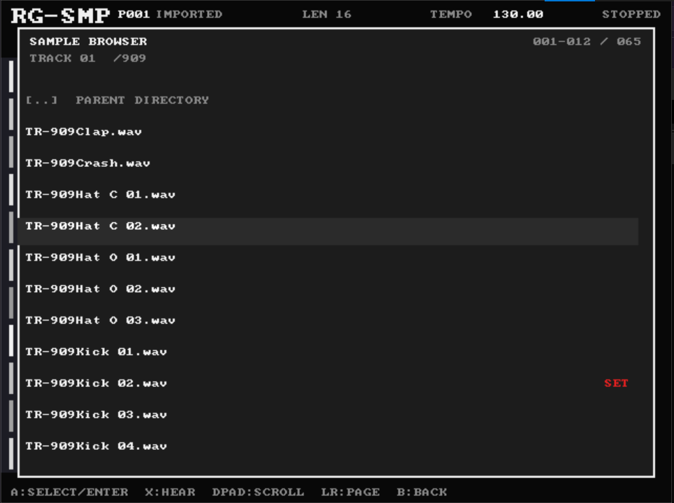
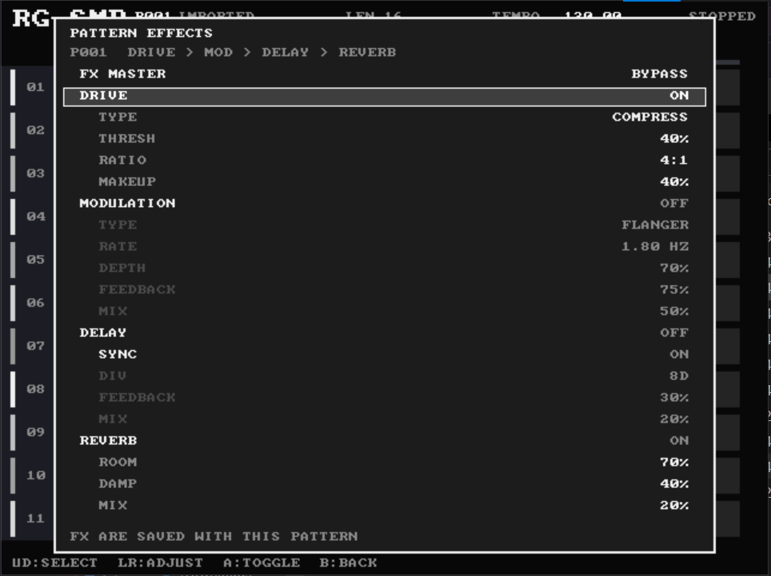

# RG-808 — a Roland TR-808 clone for the Anbernic RG35XX SP (muOS / PortMaster)






**Version 1.1** (2026-11-27). New in 1.1: USB-MIDI input (clock and transport sync, song mode follows the master), per-track pitch with time stretch, and pattern-wide sample start/end cuts. RG-808 and RG-SMP both ship as 1.1, validated on a physical RG35XX SP. RG-808 and RG-SMP both
ship as 1.0, validated on a physical RG35XX SP.

A 1–16-step, 11-track drum machine written in C with SDL2, packaged as a
PortMaster "ready-to-run" port. Per-step accents, sample-accurate sequencing,
a 200-slot pattern library, song chains with WAV export, a per-pattern master
effects chain (selectable drive, selectable modulation, tempo-synced delay,
reverb), per-track performance mute, held R1 punch-in FX, 640×480 native UI,
D-pad driven.

> **Disclaimer: this project was made with AI.** All of the source code, build
> and packaging tooling, documentation and planning in this repository were
> generated by an AI coding agent (OpenCode, running the Qwen3.8 Flash model)
> working for the project owner, who provided the sample pack, made the design
> decisions and performed all testing on real hardware. Nothing here was
> hand-written by a human programmer. Evaluate the code with that in mind.

## Layout
```
src/          C sources (engine, audio, ui, wav loader, persistence)
assets/wav/   kit sample families copied from the Roland TR-808 pack (74 files)
tools/        dev & packaging scripts (Windows + Docker + device)
tools/device/ muOS probe / installer / deploy scripts
port/         PortMaster packaging staging (RG808.sh, port.json, gameinfo, ...)
vendor/       SDL2 + public-domain font (fetched by tools/fetch-deps.ps1)
dist/         built port zip (generated)
```

## Building for local dev (Windows)
```
tools\fetch-deps.ps1          # one-time: SDL2 mingw + font
powershell tools\prepare-assets.ps1   # one-time: kit from sample pack
cmake -S . -B build -G Ninja -DRG_MACHINE=808
cmake --build build
build\rg808.exe               # run (SDL2 DLL + assets are copied next to it)
```
Useful CLI modes (no audio device needed):
```
rg808.exe --bounce out.wav --loops 4    # render the active pattern to WAV
rg808.exe --pattern 12 --bounce out.wav # render pattern slot 12
rg808.exe --pattern 1 --save-slot 7     # headless copy slot 1 -> 7
rg808.exe --song --bounce song.wav      # render the song chain once
rg808.exe --song                        # export to conf/song_<tempo>_<date>_<time>.wav
rg808.exe --test-song                   # headless song checks
rg808.exe --test-length                 # headless pattern-length checks
rg808.exe --test-fx                     # headless effects checks
rg808.exe --test-mute                   # headless performance-mute checks
rg808.exe --test-pitch                  # headless transpose DSP / cache / PIT checks
rg808.exe --test-trim                   # headless slice math / TRM checks
rg808.exe --test-midi                   # headless MIDI clock/transport engine
rg808.exe --test-usbmidi                # headless USB-MIDI input parsing
rg808.exe --test-punch                  # headless punch-in FX checks
rg808.exe --screenshot shot.bmp         # render one UI frame to BMP
rg808.exe --screenshot p.bmp --mode pattern   # pattern browser frame
```

The `core` branch carries both machines, so its suites are run for both
shells:
```
tools\test-machines.ps1     # headless suites + scripts for RG-808 and RG-SMP
```

Keyboard controls on PC: arrows=dpad, Z/Enter=A, X=B, C=X(hear), Y=mute,
Space=START, Esc/Backspace=SELECT-menu, 1/2/3/4=L1/L2/R1/R2 (hold + arrows for
shortcuts; hold 3=R1 and press a direction or Z/X/C/Y for punch-in FX),
[/]=tempo, Q=quit.

## Building for the device (muOS / PortMaster)
Requires Docker Desktop (or any docker):
```
docker build -t rg808build tools/portmaster-build
docker run --rm -v ${PWD}:/src rg808build             # -> dist/rg808.zip  (PowerShell)
docker run --rm -e MACHINE=smp -v ${PWD}:/src rg808build   # -> dist/rgsmp.zip
```
The container cross-compiles `rg808.aarch64` + `rg808.armhf` against Debian's
SDL2 (the device ships its own libSDL2 at runtime; both arch binaries are
inside the zip and the launcher picks the right one). `MACHINE` selects the
machine: the `master` branch builds the drum machine by default, and the
`core` / `sampler` branches build the sampler.

## Installing on the device
Option A — over SSH (enable SSH on muOS first):
```
powershell tools\deploy.ps1 <device-ip>
```
Option B — offline: put `dist/rg808.zip` on the SD card, or unzip it so that
the `rg808/` folder lands in `<card>/ports/` and `RG808.sh` in
`<card>/roms/PORTS/`. Launch "RG808" from Explore Content → Ports.

Before the first build, please run the device probe so we can pin the facts
(kernel, glibc, SDL2, paths):
```
tools\device\probe.sh > probe.txt 2>&1     # in Mustard Terminal
```

## Controls
| Button | Action |
|--|--|
| D-Pad | Move cursor (hold to repeat) |
| A | Cycle step: off → on → accent |
| B | Clear step (back in menus) |
| X | Hear sound of the selected track |
| Y | Mute / unmute the selected track in the sequencer |
| START | Play / stop |
| SELECT | Menu (tempo, swing, pattern length, ratchets, kits, effects, save, pattern library, song mode, clear all, quit) |
| L1 / L2 / R2 | Shoulder shortcuts — hold one and an on-screen hint appears |
| R1 + D-Pad / A B X Y | Held punch-in effects (one at a time, quantized to the next 16th) |

**Shoulder shortcuts**: hold a shoulder button and the UI shows a D-pad-shaped
cheat sheet for that button. The assigned combinations are:

| Hold + D-pad | Opens / action |
|--|--|
| L1 + Left | Tempo |
| L1 + Right | Swing |
| L1 + Up | Pattern length |
| L1 + Down | Ratchet notes |
| L1 + X | Pitch / transpose the selected track |
| L1 + B | Sample start/end (slice) for the whole track |
| L2 + Left | Pattern library |
| L2 + Right | Song mode |
| L2 + Up | Sample/kit selection |
| L2 + Down | Export song to WAV (confirmation) |
| R1 + Left/Right/Up/Down | 1/4, 1/8, 1/16, 1/32 stutter loop |
| R1 + A / B / X / Y | Rewind, 1/16 gate, tape stop, phone filter |
| R2 + Up | Drive FX |
| R2 + Left | Modulation FX |
| R2 + Down | Delay FX |
| R2 + Right | Reverb FX |

All L2 combinations are mapped. Pressing a shoulder shows the hint; releasing
it hides the hint immediately.

**Pitch**: L1 + X opens the pitch page for the selected track. Up/down move one
semitone, left/right a whole octave, A auditions and B returns; the range is
-24..+24 semitones. The shift is time-stretched, so the voice keeps its
duration and the groove stays put - the sample is re-rendered once when the
value changes and cached, so playback costs nothing. The interval is stored
with the pattern (`PIT` lines), so every song bar can transpose on its own, and
the track row shows it next to the label (`+7`). Rendering a long sample takes
a moment; the transport keeps running while it happens.

**Slice**: L1 + B opens the sample start/end page for the selected track. One
cut per track - every step of the pattern plays it - in hundredths of a percent
(`START 5.64`, `END 98.74`). Left/right or A switches between START and END,
up/down nudges the highlighted value (0.01 % per tap, coarser while held), A
also swaps START and END, X auditions the slice, B returns. The waveform shows
the whole sample with the slice lit and both edges marked. The cut is stored
with the pattern (`TRM <track> <start> <end>`) and the sequencer plays it with
a 2 ms fade at each edge so it never clicks. Older per-step `TRM` lines still
load and migrate to the first cut they contain.

**USB-MIDI in** (1.1): plug a USB-MIDI master into the Type-C port and the
machine syncs to it - MIDI clock drives the tempo, START/STOP/CONTINUE drive
the transport, and SPP positions the song. On the song page the armed chain
plays on the master's START instead of the pattern: a looping song repeats
until STOP, a non-looping one ends in standby and re-arms for the next START.
Your own tempo is restored when the device disconnects (the master's measured
tempo is only borrowed while synced, and the header shows a red `MIDI` chip in
place of the tempo), and a tempo-synced delay is bypassed while the clock
drives us. The RG35XX SP acts as a USB host automatically (verified with a
Roland T-8); the master must be plugged in while the app runs so the reader
can claim it.

**Mute**: in the sequencer, Y toggles a performance mute for the selected
instrument; X still auditions it. Muted rows are tinted and marked with a red
`M`. Mutes apply to live playback and song playback, cut any ringing hit
immediately, and are not saved with the pattern (they reset on restart).
They also apply to the WAV export: the export confirmation page lists the
muted tracks, and Y toggles whether they are part of the export.
Auditioning a muted track still works, so it stays programmable.

**Punch-in FX**: hold R1 and press a direction or face button for a momentary
master effect. Left/Right/Up/Down are 1/4, 1/8, 1/16 and 1/32 stutter loops;
A is a 1/4 rewind, B a 1/16 gate, X a tape stop (one 1/8 note to silence) and
Y a phone-style band-pass.
The overlay mirrors the SP controls: D-pad on the left, face buttons on the
right (X top, A right, B bottom, Y left). The effect starts on the next 16th
boundary, only one effect can be active at a time, and releasing the button
crossfades back to live audio. Punch-ins work during pattern and song playback
and are not saved or included in WAV export.

**Swing**: menu → EDIT SWING; 0–100 % shuffles every even 16th late
(~67 % ≈ triplet feel). **Pattern length**: menu → PATTERN LENGTH (or L1 + Up)
sets how many of the 16 steps play, from 1 to 16 (up/down ±1, left/right ±4).
Steps past the end stay visible but dimmed, so shortening and re-expanding a
pattern never destroys hidden notes; the cursor wraps at the last played step.
**Ratchets**: menu → RATCHET NOTES turns the grid into
a roll editor — A cycles each step through 2× / 3× / 4× rolls and flam
(digit drawn in the cell); in kit mode (menu → SELECT KITS) D-Pad rows =
instruments, columns = sample variants (numbered boxes); A selects +
auditions, X auditions only, B returns. Each voice ships every matching
variant from the pack (BD/SN: 16, toms: 7, CH: 5, OH: 3, CL: 2, CP: 3, CB: 2,
CY: 6). All selections are saved with the pattern.

**Effects**: menu → EFFECTS edits the active pattern's master chain:
drive → modulation → delay → reverb. The drive slot is selectable as
bitcrusher (4–16 bits, 1–32× sample-and-hold), overdrive (drive/mix) or
compression (threshold/ratio/makeup); the modulation slot is selectable as
flanger or phaser (rate/depth/feedback/mix). The delay runs 20–4000 ms or
tempo-syncs to 1/4, 1/8, 1/16, 1/4T, 1/8T, 1/16T, 4D, 8D or 16D, following the
live tempo or the current song bar. Up/down selects a row, left/right adjusts,
and A toggles the master bypass, a stage or SYNC. Effects are stored with each
pattern and autosave with it; `conf/fx.txt` is the fallback for older patterns
without FX lines. Master bypass is bit-identical to the dry render.

**Pattern library**: menu → PATTERN LIBRARY opens 200 numbered slots.
D-Pad up/down moves, left/right pages by 12, A loads the selected
slot, B returns. SELECT opens the slot actions: LOAD SLOT, SAVE HERE
(overwrite with the current editor), COPY ACTIVE HERE, RENAME (letter picker:
up/down changes the character, left/right moves, A advances, X deletes,
SELECT saves), DELETE and CANCEL. The active slot number and name are shown
in the header; edits autosave into that slot. A legacy `conf/pattern.txt`
from v1 is imported into slot 001 on first run.

**Song mode**: menu → SONG MODE (or L2+Right) chains up to 512 bars, one
pattern slot per bar. A picks the pattern for the selected bar (the pattern
browser opens in pick mode), D-Pad up/down selects, left/right pages by 12,
X jumps the cursor to the bar currently playing, and START plays/stops the
chain. SELECT opens the song actions: INSERT BAR, DELETE BAR, MOVE BAR
UP/DOWN, PLAY FROM HERE, LOOP ON/OFF, EXPORT WAV, SAVE SONG, CLEAR SONG and
CANCEL. Each bar uses the BPM, swing, length, ratchets and kit stored in its
pattern. The chain is saved in
`conf/song.txt`; EXPORT WAV streams the whole song to
`conf/song_<tempo>_<yyyymmdd>_<hhmmss>.wav` with a progress bar (44.1 kHz/16-bit
stereo, one pass plus a two-second tail). The tempo tag is bar 1's BPM, with
`_` before a fractional part (`90_5`), and a same-second name gets `_2`, `_3`,
... appended so an earlier export is never overwritten. L2+Down opens the same
export after a confirmation page.

Your pattern and tempo are saved automatically on quit (menu: QUIT) and can be
saved/loaded manually. Patterns live in `conf/patterns/NNN.txt`, with slot
names and the active slot in `conf/patterns/index.txt`; the song chain lives
in `conf/song.txt` inside the port folder on the card. Pattern files include
their FX chain, one `PIT <track> <semitones>` line per transposed track and one
`TRM <track> <start> <end>` line per cut track (0.01 % units, one cut played by
every step; legacy per-step lines are migrated);
`conf/fx.txt` supplies the fallback chain for older patterns without FX lines.
Writes go to a temp file, are flushed, then renamed into place, so an
interrupted save never truncates a pattern or song.

## Kit mapping
Each voice ships its whole variant family from the pack as `<id>NN.wav`
(e.g. `bd01..bd16` = TR-808Kick01..16). Edit the `$families` arrays in
`tools/prepare-assets.ps1` to add, remove, or reorder variants; defaults are
the `dflt` column in `src/engine.c`.

## Status / roadmap
- **Version 1.1** (2026-11-27). New in 1.1: USB-MIDI input (clock and transport sync, song mode follows the master), per-track pitch with time stretch, and pattern-wide sample start/end cuts. RG-808 and RG-SMP both ship as 1.1, validated on a physical RG35XX SP. M1–M11 are implemented;
  both ARM cross-builds pass the automated suites; controls, audio, effects,
  punch-in FX and song export were validated on a physical RG35XX SP. RG-SMP
  ships as 1.0 from the `sampler` branch.
- v1: single pattern, 11 tracks, accents, sample selection per voice
  (kit mode), save.
- v2 (shipped in 1.0): swing + ratchets (M6), 200-slot pattern library with
  rename/copy/delete and legacy import (M7), shoulder shortcut layer, song
  chains with streaming WAV export (M8), per-pattern length 1–16, and master
  effects (M9: selectable bitcrusher/overdrive/compression, flanger/phaser,
  tempo-synced delay, reverb) with per-pattern settings (M9.5), per-track
  performance mute (Y in the sequencer), and R1 punch-in FX (M11).

## Credits & licences
Code: this project (MIT where not otherwise noted). SDL2 (zlib), public-domain
font8x8, sample pack per `port/rg808/licenses/ASSETS.txt` (confirm before any
public release).
