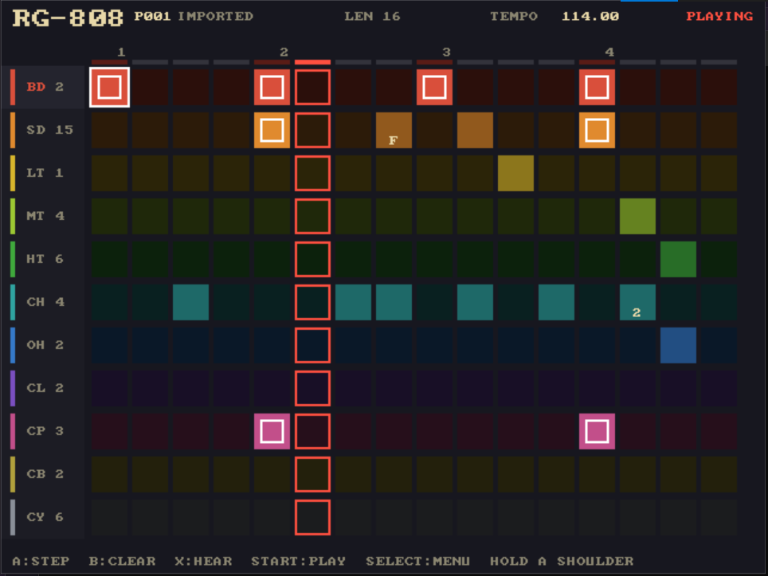

# RG-SMP - an 11-track sample drum machine for the Anbernic RG35XX SP




**Version 1.0** — first stable release (2026-11-15). RG-SMP and RG-808 both
ship as 1.0, validated on a physical RG35XX SP.

A 1-16-step, 11-track sample drum machine written in C with SDL2, packaged as a
PortMaster "ready-to-run" port. It has a recursive WAV sample browser, one
sample per track, per-step accents, sample-accurate sequencing, a 200-slot
pattern library, song chains with WAV export, a per-pattern master effects
chain, per-track mute and held R1 punch-in FX.

This is the sampler branch of the project. It shares the sequencer/pattern/
song/effects/performance stack with the earlier 808 work but uses a different
sample model, look and brand name.

## Layout

```
src/core/     shared engine, sequencer, patterns, songs, FX, punch-in FX
src/machines/ machine definitions and app shells (808, smp)
assets/wav/   tracked 808 kit; sampler/user packs live in ignored subdirs
tools/        dev, test and packaging scripts
port/         PortMaster packaging staging (RGSMP.sh, port.json, gameinfo)
vendor/       SDL2 + public-domain font (fetched by tools/fetch-deps.ps1)
dist/         built port zip (generated)
```

## Samples

WAVs live under `assets/wav/` and may be nested arbitrarily. The sample browser
walks that tree on demand. The tracked 808 kit is part of the shared tree;
sampler/user packs live in ignored subdirectories (for example `assets/wav/909`)
and are included in the port zip when present.

Samples are loaded only when the active pattern or song needs them. A single
sample is limited to 10 seconds. A song sample bank is limited to 128 unique
files / 64 MB; if a chain exceeds it, playback/export is refused with a clear
message instead of silently dropping tracks.

On the first launch (no pattern index yet), slot 001 is created as a factory
909 groove named `DEFAULT` at 130 BPM. It is written once only; deleting all
patterns later does not recreate it.

At startup, a pattern whose WAV no longer exists keeps the track silent and
shows a yellow `!` in the track header. The path is preserved so restoring the
file and reloading the pattern brings the track back.

## Building for local dev (Windows)

```
tools\fetch-deps.ps1                  # one-time: SDL2 mingw + font
cmake -S . -B build -G Ninja -DRG_MACHINE=smp
cmake --build build
build\rg808.exe                       # local binary; UI/branding is RG-SMP
```

Useful CLI modes (no audio device needed):
```
rg808.exe --assets DIR --bounce out.wav --loops 4   # render the active pattern
rg808.exe --pattern 12 --bounce out.wav             # render pattern slot 12
rg808.exe --pattern 1 --save-slot 7                 # headless copy slot 1 -> 7
rg808.exe --song --bounce song.wav                  # render the song chain once
rg808.exe --song                                   # export to conf/song_<tempo>_<date>_<time>.wav
rg808.exe --test-sampler                           # sample bank/browser/persistence
rg808.exe --test-mute                              # performance-mute checks
rg808.exe --test-pitch                             # transpose DSP / cache / PIT lines
rg808.exe --test-trim                              # slice math / TRM lines
rg808.exe --test-punch                             # punch-in FX checks
rg808.exe --test-shortcuts                         # shoulder map
rg808.exe --test-length                            # pattern-length checks
rg808.exe --screenshot shot.bmp --mode sampler     # sample browser frame
```

The core branch carries both machines, so the automated suites are run for
both shells:

```
tools\test-machines.ps1     # headless suites for the sampler and the drum machine
tools\test-mute.ps1         # single-machine suite (sampler build)
```

Keyboard controls on PC: arrows=dpad, Z/Enter=A, X=B, C=X(hear), Y=mute,
Space=START, Esc/Backspace=SELECT-menu, 1/2/3/4=L1/L2/R1/R2 (hold + arrows for
shortcuts; hold 3=R1 and press a direction or Z/X/C/Y for punch-in FX),
[/]=tempo, Q=quit.

## Building for the device (muOS / PortMaster)

Requires Docker Desktop (or any docker):
```
docker build -t rg808build tools/portmaster-build
docker run --rm -v ${PWD}:/src rg808build             # -> dist/rgsmp.zip
docker run --rm -e MACHINE=808 -v ${PWD}:/src rg808build   # -> dist/rg808.zip
```
The container cross-compiles `rgsmp.aarch64` + `rgsmp.armhf` against Debian's
SDL2. The device ships its own `libSDL2` at runtime; both arch binaries are
inside the zip and the launcher picks the right one. `MACHINE` selects the
machine (the `core` branch builds the sampler, the `master` branch the drum
machine).

## Installing on the device

Option A - over SSH (enable SSH on muOS first):
```
powershell tools\deploy.ps1 <device-ip>
```
Option B - offline: put `dist/rgsmp.zip` on the SD card, or unzip it so that
the `rgsmp/` folder lands in `<card>/ports/` and `RGSMP.sh` in
`<card>/roms/PORTS/`. Launch "RG-SMP" from Explore Content -> Ports.

## Controls

| Button | Action |
|--|--|
| D-Pad | Move cursor (hold to repeat) |
| A | Cycle step: off -> on -> accent |
| B | Clear step (back in menus) |
| X | Hear sound of the selected track |
| Y | Mute / unmute the selected track in the sequencer |
| START | Play / stop |
| SELECT | Menu (tempo, swing, pattern length, ratchets, sample browser, effects, save, pattern library, song mode, clear all, quit) |
| L1 / L2 / R2 | Shoulder shortcuts - hold one and an on-screen hint appears |
| R1 + D-Pad / A B X Y | Held punch-in effects (one at a time, quantized to the next 16th) |

**Shoulder shortcuts**: hold a shoulder button and the UI shows an on-screen
hint. The assigned combinations are:

| Hold + D-pad | Opens / action |
|--|--|
| L1 + Left | Tempo |
| L1 + Right | Swing |
| L1 + Up | Pattern length |
| L1 + Down | Ratchet notes |
| L1 + X | Pitch / transpose the selected track |
| L1 + B | Sample start/end (slice) for the selected step |
| L2 + Left | Pattern library |
| L2 + Right | Song mode |
| L2 + Up | Sample browser |
| L2 + Down | Export song to WAV (confirmation) |
| R1 + Left/Right/Up/Down | 1/4, 1/8, 1/16, 1/32 stutter loop |
| R1 + A / B / X / Y | Rewind, 1/16 gate, tape stop, phone filter |
| R2 + Up | Drive FX |
| R2 + Left | Modulation FX |
| R2 + Down | Delay FX |
| R2 + Right | Reverb FX |

All L2 combinations are mapped. Pressing a shoulder shows the hint; releasing
it hides the hint immediately.

**Pitch**: L1+X opens the pitch page for the selected track. Up/down move one
semitone, left/right move a whole octave, A auditions and B returns; the range
is -24..+24 semitones. The shift is time-stretched, so the sample keeps its
duration and the beat stays put - the sample is re-rendered once when the value
changes and cached, so playback costs nothing. The interval is stored with the
pattern (`PIT` lines), so every song bar can transpose on its own, and the
sequencer row shows it next to the track label (`+7`). Rendering a long sample
takes a moment; the transport keeps running while it happens.

**Slice**: L1+B opens the sample start/end page for the selected step. Each of
the 16 steps can play its own slice of the track's sample, in hundredths of a
percent (`START 5.64`, `END 98.74`). Left/right picks the step, up/down nudges
the highlighted value (0.01 % per tap, coarser while held), A swaps START and
END, X auditions the slice, B returns. The waveform shows the whole sample with
the slice lit and both edges marked, and the row of step cells shows which
steps are cut. Slices are stored with the pattern (`TRM` lines) and the sequencer
plays the cut, with a 2 ms fade at each cut edge so it never clicks.

**Sample browser**: menu -> SAMPLE BROWSER or L2+Up. D-pad scrolls, left/right
pages, A enters a directory or assigns/auditions a WAV to the current track,
X auditions without assigning, B returns. Directories are listed before files;
`..` is the first entry inside a subdirectory. The browser remembers the last
directory for the session.

**Mute**: Y toggles a performance mute for the selected track; X still
auditions it. Muted rows are marked with a red `M`. Mutes apply to live and
song playback, cut ringing hits immediately, and are not saved with the
pattern. They also apply to the WAV export: the export confirmation page
lists the muted tracks, and Y toggles whether they are part of the export
(excluded by default).

**Punch-in FX**: hold R1 and press a direction or face button for a momentary
master effect. Left/Right/Up/Down are 1/4, 1/8, 1/16 and 1/32 stutter loops;
A is a 1/4 rewind, B a 1/16 gate, X a tape stop (one 1/8 note to silence) and
Y a phone-style band-pass. The overlay mirrors the SP controls: D-pad on the
left, face buttons on the right (X top, A right, B bottom, Y left). The effect
starts on the next 16th boundary, only one effect can be active at a time, and
releasing the button crossfades back to live audio. Punch-ins work during
pattern and song playback and are not saved or included in WAV export.

**Voice limit**: each track keeps at most four live voices, so 3x/4x ratchets
play in full; a fifth hit steals the oldest voice on that track. This prevents
fast cymbal/hat repeats from piling up without reducing sample-bank RAM.

**Swing**: menu -> EDIT SWING; 0-100 % shuffles every even 16th late.
**Pattern length**: menu -> PATTERN LENGTH (or L1+Up) sets 1-16 steps.
**Ratchets**: menu -> RATCHET NOTES turns the grid into a roll editor - A
cycles each step through 2x / 3x / 4x rolls and flam.

**Effects**: menu -> EFFECTS edits the active pattern's master chain:
drive -> modulation -> delay -> reverb. Drive is bitcrusher, overdrive or
compression; modulation is flanger or phaser; delay is free-running or
tempo-synced; reverb has room/damp/mix. Per-pattern settings autosave with the
pattern; `conf/fx.txt` is the fallback for patterns without FX lines.

**Pattern library**: menu -> PATTERN LIBRARY opens 200 numbered slots.
D-Pad up/down moves, left/right pages by 12, A loads, B returns. SELECT opens
LOAD SLOT, SAVE HERE, COPY ACTIVE HERE, RENAME, DELETE and CANCEL. Edits
autosave into the active slot. Patterns live in `conf/patterns/NNN.txt` with
names and the active slot in `conf/patterns/index.txt`.

**Song mode**: menu -> SONG MODE (or L2+Right) chains up to 512 bars, one
pattern slot per bar. A picks the pattern for the selected bar, D-pad selects,
left/right pages, X jumps to the playing bar, START plays/stops. SELECT opens
INSERT BAR, DELETE BAR, MOVE BAR UP/DOWN, PLAY FROM HERE, LOOP ON/OFF, EXPORT
WAV, SAVE SONG, CLEAR SONG and CANCEL. Each bar uses the BPM, swing, length,
sample assignments and FX stored in its pattern. EXPORT WAV writes
`conf/song_<tempo>_<yyyymmdd>_<hhmmss>.wav` (44.1 kHz/16-bit stereo) with a
progress bar. The tempo tag is bar 1's BPM, with `_` before a fractional part
(`90_5`); an existing name gets `_2`, `_3`, ... appended so an earlier export
is never overwritten. L2+Down opens the same export after a confirmation page.

## Pattern format

Patterns are plain text: `RGSMP1`, `BPM`, `SMP <track> <relative/path.wav>`,
`PIT <track> <semitones>` for transposed tracks, `TRM <track> <16 start>
<16 end>` for sliced steps (0.01 % units), 16-character level rows,
`RCH`, `SWING`, `LEN` and the FX lines. Slots are atomic writes (temp + fsync +
rename). Paths are relative to `assets/wav`; files that are missing at startup
are shown with `!` and stay silent.

## Credits & licences

Code: this project (MIT where not otherwise noted). SDL2 (zlib),
public-domain font8x8, sample packs per `port/rgsmp/licenses/ASSETS.txt`.
Confirm the sample-pack licence terms before any public release.
