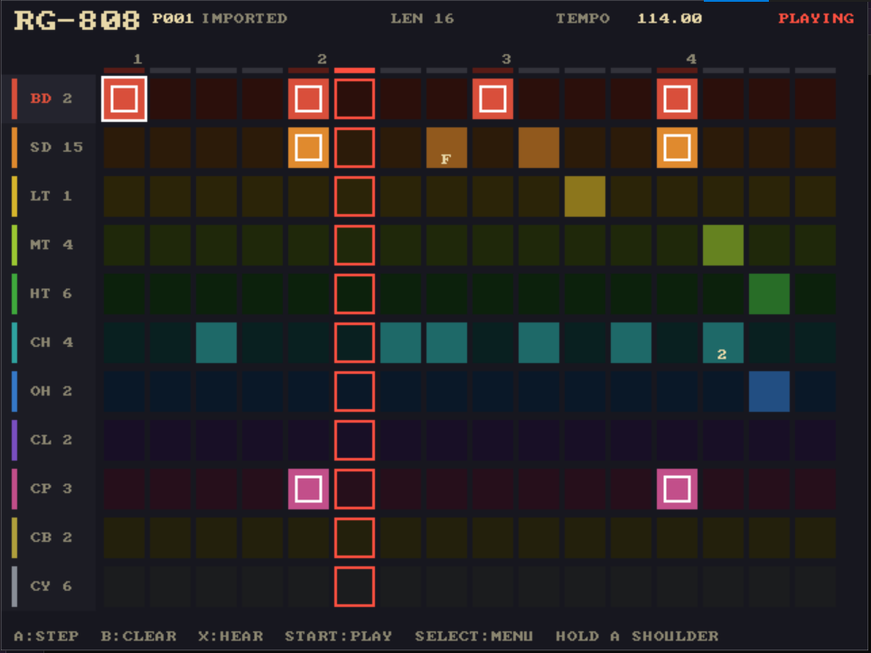
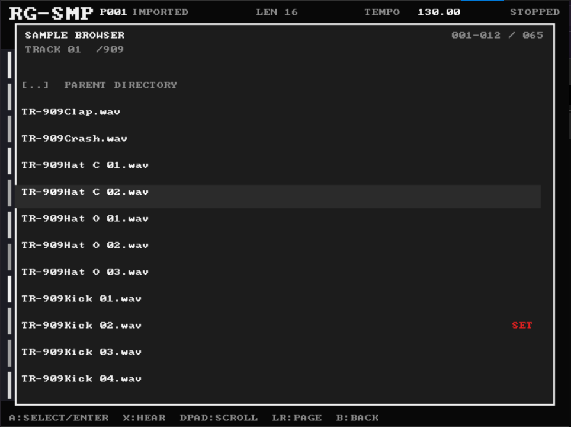
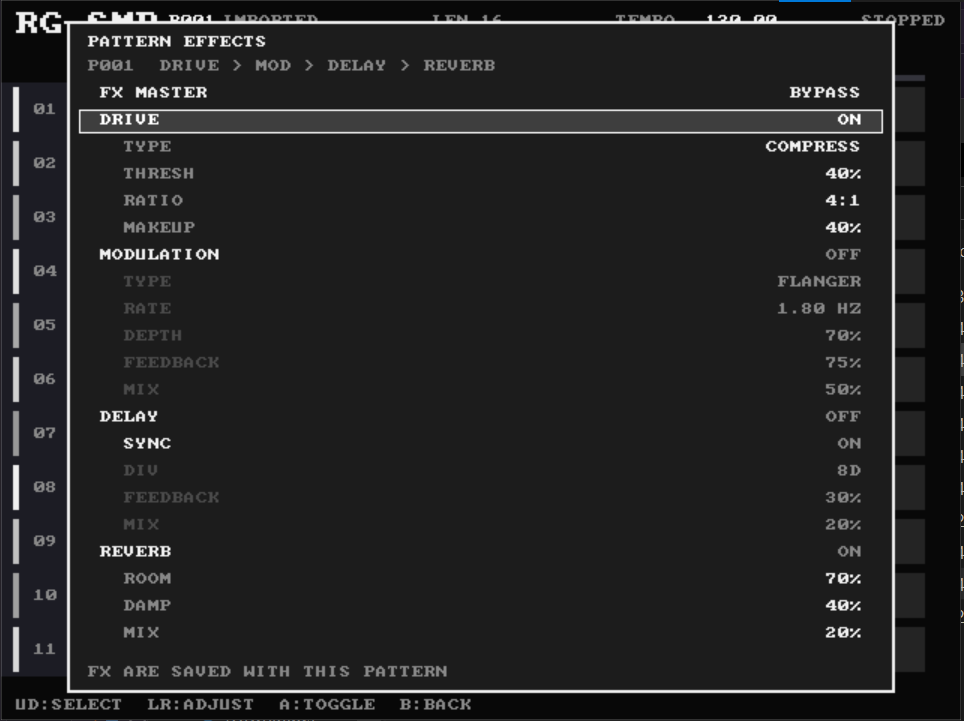

# RG-808 — a Roland TR-808 clone for the Anbernic RG35XX SP (muOS / PortMaster)







**Version 0.1** — first complete development release (2026-11-07).

A 1–16-step, 11-track drum machine written in C with SDL2, packaged as a
PortMaster "ready-to-run" port. Per-step accents, sample-accurate sequencing,
a 200-slot pattern library, song chains with WAV export, a per-pattern master
effects chain (selectable drive, selectable modulation, tempo-synced delay,
reverb), 640×480 native UI, D-pad driven.

> **Disclaimer: this project was made with AI.** All of the source code, build
> and packaging tooling, documentation and planning in this repository were
> generated by an AI coding agent (OpenCode, running the Qwen3.8 Flash model)
> working for the project owner, who provided the sample pack, made the design
> decisions and performed all testing on real hardware. Nothing here was
> hand-written by a human programmer. Evaluate the code with that in mind.

## Layout
```
src/          C sources (engine, audio, ui, wav loader, persistence)
assets/wav/   kit sample families copied from the Roland TR-808 pack (74 files)
tools/        dev & packaging scripts (Windows + Docker + device)
tools/device/ muOS probe / installer / deploy scripts
port/         PortMaster packaging staging (RG808.sh, port.json, gameinfo, ...)
vendor/       SDL2 + public-domain font (fetched by tools/fetch-deps.ps1)
dist/         built port zip (generated)
```

## Building for local dev (Windows)
```
tools\fetch-deps.ps1          # one-time: SDL2 mingw + font
powershell tools\prepare-assets.ps1   # one-time: kit from sample pack
cmake -S . -B build -G Ninja
cmake --build build
build\rg808.exe               # run (SDL2 DLL + assets are copied next to it)
```
Useful CLI modes (no audio device needed):
```
rg808.exe --bounce out.wav --loops 4    # render the active pattern to WAV
rg808.exe --pattern 12 --bounce out.wav # render pattern slot 12
rg808.exe --pattern 1 --save-slot 7     # headless copy slot 1 -> 7
rg808.exe --song --bounce song.wav      # render the song chain once
rg808.exe --song                        # export to conf/song.wav
rg808.exe --test-song                   # headless song checks
rg808.exe --test-length                 # headless pattern-length checks
rg808.exe --test-fx                     # headless effects checks
rg808.exe --screenshot shot.bmp         # render one UI frame to BMP
rg808.exe --screenshot p.bmp --mode pattern   # pattern browser frame
```
Keyboard controls on PC: arrows=dpad, Z/Enter=A, X=B, C=X(hear), Y=mute,
Space=START, Esc/Backspace=SELECT-menu, 1/2/3/4=L1/L2/R1/R2 (hold + arrows for
shortcuts), [/]=tempo, Q=quit.

## Building for the device (muOS / PortMaster)
Requires Docker Desktop (or any docker):
```
docker build -t rg808build tools/portmaster-build
docker run --rm -v ${PWD}:/src rg808build      # -> dist/rg808.zip  (PowerShell)
```
The container cross-compiles `rg808.aarch64` + `rg808.armhf` against Debian's
SDL2 (the device ships its own libSDL2 at runtime; both arch binaries are
inside the zip and the launcher picks the right one).

## Installing on the device
Option A — over SSH (enable SSH on muOS first):
```
powershell tools\deploy.ps1 <device-ip>
```
Option B — offline: put `dist/rg808.zip` on the SD card, or unzip it so that
the `rg808/` folder lands in `<card>/ports/` and `RG808.sh` in
`<card>/roms/PORTS/`. Launch "RG808" from Explore Content → Ports.

Before the first build, please run the device probe so we can pin the facts
(kernel, glibc, SDL2, paths):
```
tools\device\probe.sh > probe.txt 2>&1     # in Mustard Terminal
```

## Controls
| Button | Action |
|--|--|
| D-Pad | Move cursor (hold to repeat) |
| A | Cycle step: off → on → accent |
| B | Clear step (back in menus) |
| X | Hear sound of the selected track |
| Y | Mute / unmute the selected track in the sequencer |
| START | Play / stop |
| SELECT | Menu (tempo, swing, pattern length, ratchets, kits, effects, save, pattern library, song mode, clear all, quit) |
| L1 / L2 / R1 / R2 | Shoulder shortcuts — hold one and a D-pad hint appears |

**Shoulder shortcuts**: hold a shoulder button and the UI shows a D-pad-shaped
cheat sheet for that button. The assigned combinations are:

| Hold + D-pad | Opens |
|--|--|
| L1 + Left | Tempo |
| L1 + Right | Swing |
| L1 + Up | Pattern length |
| L2 + Left | Pattern library |
| L2 + Right | Song mode |
| R1 + Left | Sample/kit selection |
| R1 + Right | Ratchet notes |
| R2 + Up | Drive FX |
| R2 + Left | Modulation FX |
| R2 + Down | Delay FX |
| R2 + Right | Reverb FX |

Other combinations are reserved for future features. Pressing a shoulder shows
the hint; releasing it hides the hint immediately.

**Mute**: in the sequencer, Y toggles a performance mute for the selected
instrument; X still auditions it. Muted rows are tinted and marked with a red
`M`. Mutes apply to live playback and song playback, cut any ringing hit
immediately, and are not saved with the pattern (they reset on restart).
Auditioning a muted track still works, so it stays programmable.

**Swing**: menu → EDIT SWING; 0–100 % shuffles every even 16th late
(~67 % ≈ triplet feel). **Pattern length**: menu → PATTERN LENGTH (or L1 + Up)
sets how many of the 16 steps play, from 1 to 16 (up/down ±1, left/right ±4).
Steps past the end stay visible but dimmed, so shortening and re-expanding a
pattern never destroys hidden notes; the cursor wraps at the last played step.
**Ratchets**: menu → RATCHET NOTES turns the grid into
a roll editor — A cycles each step through 2× / 3× / 4× rolls and flam
(digit drawn in the cell); in kit mode (menu → SELECT KITS) D-Pad rows =
instruments, columns = sample variants (numbered boxes); A selects +
auditions, X auditions only, B returns. Each voice ships every matching
variant from the pack (BD/SN: 16, toms: 7, CH: 5, OH: 3, CL: 2, CP: 3, CB: 2,
CY: 6). All selections are saved with the pattern.

**Effects**: menu → EFFECTS edits the active pattern's master chain:
drive → modulation → delay → reverb. The drive slot is selectable as
bitcrusher (4–16 bits, 1–32× sample-and-hold), overdrive (drive/mix) or
compression (threshold/ratio/makeup); the modulation slot is selectable as
flanger or phaser (rate/depth/feedback/mix). The delay runs 20–4000 ms or
tempo-syncs to 1/4, 1/8, 1/16, 1/4T, 1/8T, 1/16T, 4D, 8D or 16D, following the
live tempo or the current song bar. Up/down selects a row, left/right adjusts,
and A toggles the master bypass, a stage or SYNC. Effects are stored with each
pattern and autosave with it; `conf/fx.txt` is the fallback for older patterns
without FX lines. Master bypass is bit-identical to the dry render.

**Pattern library**: menu → PATTERN LIBRARY opens 200 numbered slots.
D-Pad up/down moves, left/right pages by 12, A loads the selected
slot, B returns. SELECT opens the slot actions: LOAD SLOT, SAVE HERE
(overwrite with the current editor), COPY ACTIVE HERE, RENAME (letter picker:
up/down changes the character, left/right moves, A advances, X deletes,
SELECT saves), DELETE and CANCEL. The active slot number and name are shown
in the header; edits autosave into that slot. A legacy `conf/pattern.txt`
from v1 is imported into slot 001 on first run.

**Song mode**: menu → SONG MODE (or L2+Right) chains up to 512 bars, one
pattern slot per bar. A picks the pattern for the selected bar (the pattern
browser opens in pick mode), D-Pad up/down selects, left/right pages by 12,
X jumps the cursor to the bar currently playing, and START plays/stops the
chain. SELECT opens the song actions: INSERT BAR, DELETE BAR, MOVE BAR
UP/DOWN, PLAY FROM HERE, LOOP ON/OFF, EXPORT WAV, SAVE SONG, CLEAR SONG and
CANCEL. Each bar uses the BPM, swing, length, ratchets and kit stored in its
pattern. The chain is saved in
`conf/song.txt`; EXPORT WAV streams the whole song to `conf/song.wav` with a
progress bar (44.1 kHz/16-bit stereo, one pass plus a two-second tail).

Your pattern and tempo are saved automatically on quit (menu: QUIT) and can be
saved/loaded manually. Patterns live in `conf/patterns/NNN.txt`, with slot
names and the active slot in `conf/patterns/index.txt`; the song chain lives
in `conf/song.txt` inside the port folder on the card. Pattern files include
their FX chain; `conf/fx.txt` supplies the fallback chain for older patterns
without FX lines. Writes go to a temp file, are flushed, then renamed into
place, so an interrupted save never truncates a pattern or song.

## Kit mapping
Each voice ships its whole variant family from the pack as `<id>NN.wav`
(e.g. `bd01..bd16` = TR-808Kick01..16). Edit the `$families` arrays in
`tools/prepare-assets.ps1` to add, remove, or reorder variants; defaults are
the `dflt` column in `src/engine.c`.

## Status / roadmap
- **Version 0.1** (2026-11-07): first complete development release. M1–M10
  are implemented on PC and both ARM cross-builds; physical-device validation
  and CPU tuning are still pending.
- v1: single pattern, 11 tracks, accents, sample selection per voice
  (kit mode), save.
- v2 (in progress): swing + ratchets (M6), 200-slot pattern library with
  rename/copy/delete and legacy import (M7), shoulder shortcut layer, song
  chains with streaming WAV export (M8), per-pattern length 1–16, and master
  effects (M9: selectable bitcrusher/overdrive/compression, flanger/phaser,
  tempo-synced delay, reverb) with per-pattern settings (M9.5), and per-track
  performance mute (Y in the sequencer).

## Credits & licences
Code: this project (MIT where not otherwise noted). SDL2 (zlib), public-domain
font8x8, sample pack per `port/rg808/licenses/ASSETS.txt` (confirm before any
public release).
